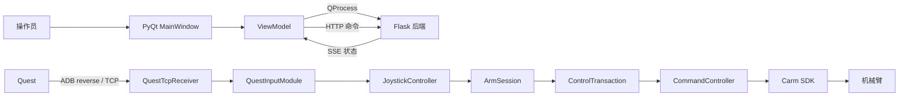
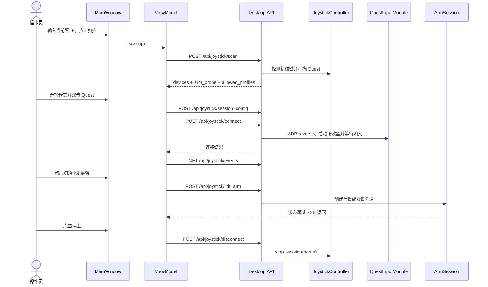

# CARM Quest Desktop 整体架构

本文面向维护者，描述当前仓库中可以从源码确认的运行结构、模块边界、数据流、状态管理、Quest 输入链、机械臂控制链和 HTTP/SSE API。

## 1. 系统组成

应用运行时包含两个本机进程：

1. PyQt6 桌面进程：显示界面、管理用户工作流、发送命令并展示状态。
2. Flask 后端进程：管理 Quest 连接、输入数据、机械臂会话、控制循环和资源清理。

桌面进程通过 `QProcess` 启动后端。两者使用 `127.0.0.1:1999` 上的 HTTP 和 SSE 通信。Quest 数据通过 ADB reverse 到达后端监听的 `127.0.0.1:9999`，不会经过 Qt 事件循环。



## 2. 模块边界

| 层级 | 主要代码 | 职责 |
|---|---|---|
| 桌面视图 | `qt_app/app/main_window.py` | 创建控件、接收用户操作、根据状态控制可用性 |
| 桌面编排 | `qt_app/app/view_model.py` | 启动后端、组织扫描/连接/初始化/停止流程、过滤迟到响应 |
| 桌面通信 | `http_client.py`、`sse_client.py`、`backend_process.py` | HTTP、SSE 与后端子进程生命周期 |
| 后端组合 | `server/desktop/app.py`、`runtime.py` | 创建 Flask 服务、注入唯一 controller、机械臂探测、心跳和进程级清理 |
| API 适配 | `server/api/joystick_routes.py` | 把 HTTP/SSE 请求映射到 controller |
| 会话主体 | `server/basic/joystick/session/controller.py` | 输入会话、共享状态、SSE 快照、机械臂会话和停止编排 |
| 实时事务 | `server/basic/joystick/session/control_transaction.py` | 单个 ArmRuntime 的输入采样、策略门禁、物理派发和终止回报 |
| 输入信箱 | `server/basic/joystick/core/mailbox.py` | 每手单槽最新值信箱、冻结输入帧和输入发布唤醒信号 |
| 末端发送 | `server/basic/joystick/session/end_effector_sender.py` | 每臂一个最新值发送线程，把末端 SDK 阻塞调用移出控制环 |
| 运行统计 | `server/basic/joystick/session/control_stats.py` | 按 5 秒窗口汇总控制周期、步时、派发和输入频率 |
| 清理事务 | `server/basic/joystick/session/cleanup.py` | 冻结清理身份、编排 arm/provider 清理并保留失败 owner 供重试 |
| 状态投影 | `server/basic/joystick/session/observation.py` | 生成不可变 Host 快照，并分别投影 HTTP 和 SSE 兼容载荷 |
| 输入注册 | `server/basic/joystick/sources/registry.py` | 设备扫描身份、source lease 和模块生命周期 |
| Quest 适配 | `include/quest/` | ADB 扫描、TCP 协议、输入解析、重连、设备电量读取和资源回收 |
| 机械臂会话 | `server/basic/joystick/session/arm.py` | 单臂/双臂 binding、初始化、控制线程和停止 |
| 控制计算 | `server/basic/joystick/core/` | 坐标变换、目标计算、命令门禁和末端命令 |
| 输入合同 | `include/carm_teleop_input_contracts.py` | provider 能力位、设备、lease、输入批次、设备状态项和传输事件的数据结构 |

组合关系由 `server/desktop/app.py` 建立：`DesktopRuntime` 创建一个 `JoystickController`，随后将同一个 controller 注入所有 joystick 路由。

## 3. 启动流程

根目录脚本只负责转发参数：

- Windows：`run_windows.ps1` 调用 `qt_app/run_windows.ps1`
- Linux：`run_linux.sh` 调用 `qt_app/run_linux.sh`

平台脚本依次执行：

1. 检查 Python 版本是否在 3.8 – 3.12 之间。
2. 创建 `qt_app/.venv-windows` 或 `qt_app/.venv-linux`。
3. 检查依赖，缺失时从 `qt_app/requirements.txt` 安装；NumPy 和 SciPy 用环境标记区分 Python 3.8 与 3.9 及以上的固定版本。
4. 执行 `qt_app/preflight.py`。
5. 从仓库根目录运行 `qt_app/main.py`。

`preflight.py` 检查 Python 依赖、Carm 包版本、ADB 命令、端口 `1999` 和 `9999`、运行所需文件以及 Quest 模块导入。

`qt_app/main.py` 加载包内可用的末端实现，创建 `QApplication`、配置日志、再次执行启动检查，然后创建 `MainWindow`。`ViewModel.start()` 通过 `BackendProcess` 启动：

```text
<当前虚拟环境 Python> -m server.desktop.app --end-effector <name>
```

默认模式是 `carm`。Windows 包装器接受 `--end-effector` 和 `-EndEffector`，Linux 包装器原样转发 `--end-effector`。启动时会从 `server/basic/joystick/end_effectors/` 按名称动态加载包内实现；当前仓库提供 `carm`、`passthrough`，以及不控制硬件的 `blank` 开发示例。名称只受 Python 标识符格式约束；模块不存在或实现不符合末端合同时，启动会明确失败。

后端启动后监听 `127.0.0.1:1999`。Qt 每 250 ms 请求一次 `/api/desktop/health`，返回的 `instance_token` 与本窗口生成的 token 相同时，才进入 `Idle` 状态并开始每秒 heartbeat。

## 4. 用户工作流



扫描先调用 `probe_current_arm()` 读取当前机械臂的 `arm_name` 和 `arm_dof`，由 `identify_arm_model()` 识别型号，再扫描 ADB 设备：

| 探测结果 | 识别型号 | 界面可选模式 |
|---|---|---|
| 名称唯一包含 `A3`，且唯一包含 `C`/`T`/`S` 之一，自由度为 6 | `A3_C` / `A3_T` / `A3_S` | `a3_single`、`a3_dual` |
| 名称唯一包含 `D3`，自由度为 7 | `D3` | `d3_dual` |

名称同时包含 `A3` 和 `D3`、A3 分型缺失或不唯一、自由度与型号不符时，扫描直接失败。连接机械臂时同样按型号识别，并用 `型号 -> 模式 -> 臂侧` 解析初始化关节配置；D3 只支持双臂。

单臂只创建 master binding。双臂创建 master 和 slave binding：

- 两个 IP 及其控制 endpoint 都不同时，分别连接两个管理 IP；master 绑定界面选择的手柄侧，slave 绑定另一侧。
- 两个 IP 相同或解析到同一控制 endpoint 时视为同板双臂（D3 人形双臂）：master 使用 `arm_index=0` 并固定绑定左手柄，slave 使用 `arm_index=1` 并固定绑定右手柄，忽略界面选择的手柄侧。
- 桌面端所有机械臂都通过管理 IP 的 `8090` 端口连接。

每个 ArmRuntime 在 Carm 连接准备完成后创建自己的末端 Driver。输入源、单/双臂和同/异板拓扑不决定末端实现：`carm` 等价封装原生 flange/gripper/hand，`passthrough` 将一个归一化 trigger 映射为六指相同目标，并依次发送六个 `mode=0` CAN-FD 帧。

Driver 由每臂一个 `AsyncEndEffectorSender` 包装：控制环在严格位姿派发成功后只提交最新 trigger，不等待 SDK 应答；独立线程在值变化、距上次发送超过 0.5 秒（保活）或上次发送失败时调用真实 Driver。停止或控制环异常时丢弃待发值，回零和断开前等待在途发送结束。Driver 本身不创建队列、去重或重试状态，也不把发送尝试解释为物理执行成功。

## 5. 数据流

### 5.1 命令流

```text
MainWindow
  -> ViewModel
  -> HttpClient
  -> Flask route
  -> DesktopRuntime operation gate
  -> JoystickController
```

`HttpClient` 为每个请求分配递增的 `request_id`。对于扫描、会话配置、连接、初始化、断开和关闭等关键工作流请求，ViewModel 只处理当前保存的 request ID，已被新操作替代的响应不会推进工作流状态。

扫描、会话配置、连接、初始化和断开请求还携带 `_desktop_generation`。后端要求它是非负整数，并拒绝小于已接收最新 generation 的操作。

`JoystickController.user_operation()` 对用户操作做排他准入：同一时间只允许一个操作执行，另一个操作正在进行时新请求直接失败（“另一个遥操操作正在执行”），不排队。各操作还受会话相位约束：

| 操作 | 允许的会话相位 |
|---|---|
| `scan`、`connect` | `IDLE` |
| `init_arm` | `CONNECTED` |
| `session_config` | `IDLE`、`CONNECTED` |
| `disconnect` | `IDLE`、`CONNECTED`、`READY`、`CLEANUP_FAILED` |
| 其他设置（yaw、灵敏度、数据显示侧等） | `IDLE`、`CONNECTED`、`READY` |

`connect` 还要求地址来自本次扫描结果，否则返回“请先扫描并选择设备”。

### 5.2 Quest 输入流

```text
Quest TCP 帧
  -> QuestTcpReceiver
  -> QuestInputModule
  -> RawInputBatch（同一帧内的左右手数据）
  -> JoystickController
  -> QuestInputPolicy
  -> 每手单槽信箱（LatestValueCell）+ 发布信号（PublicationSignal）
  -> 对应 ArmRuntime 的 ControlTransaction
  -> CommandController 目标计算
```

`QuestTcpReceiver` 接收换行分隔的 JSON 记录。连接必须先完成 protocol 2 的 `hello` / `hello_ack` 协商，之后才接收位姿帧和 heartbeat。

`QuestInputModule` 将一帧输入转换成不可变的 `RawInputBatch`。批次带有 source lease、transport generation 和 batch sequence，用来阻止旧连接的数据进入当前会话。

`QuestInputPolicy` 检查双手帧的一致性、位姿有效性和配置的位姿跳变阈值，并为控制派发产生与当前输入状态绑定的 token。

通过策略检查的帧在同一个策略锁临界区内写入每手单槽信箱：双手同批落地，新帧直接覆盖旧帧，控制环只读取最新帧。写入后 `PublicationSignal` 唤醒等待新输入的控制环；信号只做唤醒，不携带数据。

### 5.3 机械臂控制流

```text
ControlTransaction 输入快照与策略门禁
  -> CommandController 目标计算
  -> 坐标变换与灵敏度
  -> 生成相对位姿目标
  -> 校验输入/控制/连接代际
  -> Carm.dispatch_pose_for_connection()
  -> Carm.track_pose()
  -> 当前机械臂连接
```

每个机械臂对应一个 `CommandController`、一个 `ControlTransaction` 和一个控制线程。`ControlTransaction` 拥有完整实时循环；`CommandController` 负责目标计算和单臂操作，不拥有循环线程。

控制循环的节拍由输入源能力位 `input_clocked_control` 决定，周期常量为 `control_transaction.py` 中的 `_CONTROL_LOOP_HZ = 72.0`：

- Quest 声明了该能力位：每次输入发布后立即唤醒控制环；步内已有新帧时直接进入下一步，没有新帧时最长等待 1/72 秒兜底，用于反馈刷新、Grip 释放和停止检查。Quest 策略的帧屏障保证每帧最多派发一次。
- 未声明的输入源按 72 Hz 绝对时间节拍运行，避免“执行后再 sleep”造成的周期漂移；落后时不追赶。

`ControlLoopStats` 在控制线程内按 5 秒窗口统计控制周期、步时、派发与输入频率、跳帧数和“帧发布到物理派发”延迟，不参与控制判断；当前源码中它的周期日志输出已被注释，不会写入日志。末端发送器的 `[EndEffectorStats]` 统计仍按 5 秒窗口写入后端日志。

控制代码中的主要手柄语义：

| 输入 | 当前行为 |
|---|---|
| Grip 大于 100 | 允许生成位姿目标；首次按下时同步机械臂反馈基准 |
| 松开 Grip | 清除待发目标并等待下次重新同步 |
| Trigger | 交给启动时选择的末端实现解释；`carm` 按 SDK 上下限插值，`passthrough` 映射为六个 `0..1000` 目标 |
| A/X 且未按 Grip | 发送配置中的初始化关节位置 |
| B/Y | 切换旋转锁定状态并重建映射基准 |

末端实现由启动参数选择，并在机械臂准备阶段创建：

- `carm`：根据 Carm SDK 的末端配置执行原生末端控制；flange 或零自由度时不发送末端命令。
- `passthrough`：将触发值映射为六指目标，依次发送六个 `mode=0` CAN-FD 帧。
- 其他包内实现：由其 `EndEffectorBase` 子类负责参数校验和派发语义。

末端实现不再由核心控制代码写死。新增实现放入 `server/basic/joystick/end_effectors/`，定义唯一的 `NAME` 和 `set_eff`，由启动时的包扫描发现。完整扩展合同与验证方法见 [新增末端控制方式](END_EFFECTOR_DEVELOPMENT.md)。

### 5.4 状态展示流

```text
JoystickState
  -> JoystickController.get_observation_snapshot()
  -> project_sse_payload()
  -> /api/joystick/events
  -> SseClient
  -> ViewModel._event()
  -> MainWindow.render_snapshot()
```

SSE 每 50 ms 检查一次观察序列号（observation sequence）。序列变化时立即发送快照；连续 3 秒无变化时发送 heartbeat 帧。Qt 当前将顶层 `pose` 和 `button` 展示在界面中，在连接期间把 `status.device_status` 渲染到状态行右侧，回填 `status.yaw` 到标定滑条，并根据 transport 和 terminal 状态更新提示。

## 6. 状态与生命周期

### 6.1 Qt 工作流状态

`UiState.name` 使用以下状态：

| 状态 | 含义 |
|---|---|
| `BackendStarting` | 后端正在启动和认领 |
| `Idle` | 可以扫描 |
| `Scanning` | 正在探测机械臂并扫描 Quest |
| `ScanReady` | 已有扫描结果，可以选择配置并连接 |
| `Connecting` | 正在提交配置并连接 Quest |
| `Connected` | Quest 已连接，可以初始化机械臂 |
| `Initializing` | 正在初始化机械臂 |
| `Teleoperating` | 机械臂初始化完成 |
| `Stopping` | 正在停止会话 |
| `ShuttingDown` | 窗口关闭流程正在清理后端 |
| `BackendFailed` / `BackendStopped` | 后端启动失败或已停止 |

窗口关闭还使用独立的 `ShutdownState`：`NONE`、`STOPPING_SESSION`、`REQUESTING_BACKEND_SHUTDOWN`、`WAITING_PROCESS_EXIT`、`COMPLETE`。

### 6.2 后端生命周期

`DesktopRuntime` 使用以下生命周期：

```text
running
  -> shutdown_requested
  -> cleaning
  -> cleaned
  -> server_stopping
  -> stopped
```

清理失败时进入 `retry_wait`，按 1 秒、2 秒、5 秒的间隔继续重试，后续保持 5 秒间隔。

手动停止时，Qt 先关闭本地 SSE 订阅，再请求 `home` 清理。若后端因 Carm reader 或其他 owner 尚未释放而返回失败，界面保持 `Stopping`，使用同一 workflow generation 按 1 秒、2 秒、5 秒上限继续请求清理；只有后端确认全部 owner 已释放后才进入 `Idle`。

Qt 每秒调用一次 `/api/desktop/heartbeat`。后端首次启动有 10 秒等待时间；收到 heartbeat 后，连续 3 秒未刷新会触发进程级 `hold` 清理。

### 6.3 Source binding

输入连接使用 `SourceLease` 和 `ActiveSourceBinding` 标识所有权：

```text
PROVISIONAL -> ACTIVE -> CLOSED
```

只有 ACTIVE 且 `input_ready=true` 的 binding 可以参与控制。lease 中的 provider、module instance 和 input generation 必须与当前连接匹配。

## 7. Quest 连接与协议

Quest 连接由 `QuestInputModule.connect()` 完整管理：

1. 检查 ADB 设备状态和 Quest 身份。
2. 创建并启动 `QuestTcpReceiver`。
3. 执行 `adb reverse tcp:9999 tcp:9999`。
4. 启动源码中配置的 Quest 包。
5. 等待 protocol handshake 和首个有效输入帧。

协议常量位于 `include/quest/constants.py`：

| 项目 | 当前值 |
|---|---|
| TCP 地址 | `127.0.0.1:9999` |
| 协议版本 | `2` |
| 控制记录前缀 | `@carm-control/2 ` |
| handshake 超时 | 5 秒 |
| 接收超时 | 5 秒 |
| 首帧等待时间 | 20 秒 |
| 单行上限 | 64 KiB |

握手完成后支持：

- 普通双手输入帧。
- `heartbeat` / `heartbeat_ack`。
- 后端清理时尽力发送 `session_end`。
- 无效记录返回 `protocol_error` 并终止当前连接。

普通传输断开进入 5 秒恢复窗口。协议错误、无效输入帧或 listener 错误属于 terminal 错误，不进入普通恢复路径。

### 7.1 设备状态

OpenXR 运行时不向应用暴露手柄电量，因此 Quest 连接就绪后由 `QuestDeviceStatusPoller` 每 15 秒通过 ADB 读取一次（单次命令超时 5 秒）：

| 状态项 `id` | 中文标签 | 来源 |
|---|---|---|
| `headset_battery` | 头盔 | `dumpsys battery` 的 `level` / `scale` |
| `left_controller_battery` | 左手柄 | `dumpsys OVRRemoteService` 的 `Battery` |
| `right_controller_battery` | 右手柄 | `dumpsys OVRRemoteService` 的 `Battery` |

单位均为 `%`。`ExternalStatus` 不是 `CONNECTED*` 的手柄标记为 `stale`；读不到的项值为 `null`，不报错。轮询随 source lease 摘除而停止，迟到的发布由身份复核丢弃；会话断开或停止时 Host 清空状态项。

## 8. 停止与清理

停止模式只有 `home` 和 `hold`：

| 模式 | 行为 |
|---|---|
| `home` | 停止控制线程后，将机械臂移动到零关节位置，再断开 |
| `hold` | 停止控制线程、清除目标并断开，不发送回零运动 |

界面“停止手柄遥操”先关闭本地 SSE 订阅，再请求 `home`。如果输入已经断开，controller 会将 `home` 降级为 `hold`。窗口关闭请求 `hold`，桌面 heartbeat 超时和后端退出也固定执行 `hold`。

会话清理包含：

1. 停止机械臂控制线程。
2. 根据 stop mode 决定是否回零。
3. 关闭 source binding。
4. 删除 ADB reverse。
5. 通过 ADB 对源码中配置的 Quest 包执行 `force-stop`。
6. 停止并回收 `QuestTcpReceiver`。
7. 重置 joystick 状态。

进程级清理还会关闭 source registry、joystick 清理线程和 Flask server。资源清理返回失败时，`DesktopRuntime` 不会把 lifecycle 标记为完成，而是继续重试。

## 9. HTTP API

### 9.1 通用约定

- Base URL：`http://127.0.0.1:1999`
- JSON 接口的结果字段位于响应顶层。
- `code: 1` 表示业务成功，`code: 0` 表示业务失败。
- 业务失败通常仍返回 HTTP 200，调用方必须检查 `code`。
- 服务绑定 loopback；响应包含 `Access-Control-Allow-Origin: *`。

成功响应：

```json
{
  "msg": "操作结果",
  "code": 1
}
```

失败响应：

```json
{
  "msg": "错误原因",
  "code": 0
}
```

### 9.2 接口总表

| 方法与路径 | 请求字段 | 主要响应数据 | 作用 |
|---|---|---|---|
| `GET /api/desktop/health` | 无 | `data.ready`、`pid`、`instance_token`、`log_file`、lifecycle 字段 | Qt 认领后端并读取清理状态 |
| `POST /api/desktop/heartbeat` | 空 JSON | 无额外数据 | 刷新桌面 heartbeat |
| `POST /api/desktop/shutdown` | 空 JSON | `data.lifecycle`、`cleanup_complete`、`retryable`、`attempt` | 请求进程级清理 |
| `POST /api/joystick/scan` | `current_arm_ip`、`_desktop_generation` | `data`、`arm_probe`、`allowed_profiles` | 探测机械臂并扫描 Quest |
| `POST /api/joystick/session_config` | `mode`、`master_side`、`view_side`、`slave_ip`、`_desktop_generation` | 无额外数据 | 保存连接前配置 |
| `POST /api/joystick/connect` | `address`、可选 `name`、`_desktop_generation` | `data.outcome`：`ready`、`pending` 或 `failed` | 连接扫描到的 Quest |
| `POST /api/joystick/init_arm` | `mode`、`master_ip`、`slave_ip`、`master_side`、`_desktop_generation` | 无额外数据 | 创建并初始化机械臂会话 |
| `POST /api/joystick/yaw` | `value` | 无额外数据 | 设置 Yaw 标定角度，`-180..180` 的整数；0 为前，+90 为左，-90 为右 |
| `POST /api/joystick/calibration` | `value` | 无额外数据 | 兼容旧版四档标定，`0..3` 分别映射为 yaw `+90`、`-90`、`0`、`180` |
| `POST /api/joystick/scale` | `value` | 无额外数据 | 设置灵敏度，范围 `0.1..2.0` |
| `POST /api/joystick/view_side` | `value` | 无额外数据 | 设置兼容视图侧，`left` 或 `right` |
| `POST /api/joystick/disconnect` | `stop_mode`、`reason`、`_desktop_generation` | `data.status` 状态对象 | 停止当前会话 |
| `GET /api/joystick/status` | 无 | `data` 状态对象 | 获取当前状态快照 |
| `GET /api/joystick/events` | 无 | SSE 数据流 | 订阅状态和输入快照 |

### 9.3 扫描响应

```json
{
  "data": [
    {
      "name": "设备名称",
      "address": "ADB_SERIAL"
    }
  ],
  "arm_probe": {
    "ip": "10.42.0.101",
    "arm_name": "机械臂名称",
    "arm_dof": 6,
    "family": "A3"
  },
  "allowed_profiles": [
    "a3_single",
    "a3_dual"
  ],
  "msg": "扫描完成",
  "code": 1
}
```

### 9.4 Status 数据

`GET /api/joystick/status` 的 `data` 包含：

- `ble_connected`、`arm_initialized`、`status`
- `yaw`（当前标定角度）、`calibration`（yaw 恰为四档值时为 `0..3`，否则为 `null`）、`scale`
- `device_status`：输入源声明的设备状态项列表，见 [7.1 设备状态](#71-设备状态)
- `source_type`、`is_quest_device`
- `mode`、`master_side`、`view_side`
- `capabilities`：当前输入源的能力位；`arm_profile`：当前输入源支持的型号与模式
- `master_arm`、`slave_arm`
- 当前 view side 的 `pose`、`button`
- `transport.state`、`protocol`、`connection_id`、`last_rx_age_ms`、`disconnect_reason`
- controller 不可用时附带 `available: false`

`device_status` 每一项的结构：

```json
{
  "id": "headset_battery",
  "label": {"zh-CN": "头盔", "en-US": "Headset"},
  "value": 82,
  "unit": "%",
  "stale": false
}
```

`label` 和文本型 `value` 以 `{语言: 文本}` 给出，至少包含 `zh-CN` 和 `en-US`；数值、布尔和单位与语言无关。Qt 界面取 `zh-CN`。

## 10. SSE 契约

订阅：

```http
GET /api/joystick/events
Accept: text/event-stream
```

变化帧的顶层结构：

```json
{
  "sequence": 1,
  "pose": null,
  "button": null,
  "status": {
    "ble_connected": true,
    "status": "connected",
    "calibration": 1,
    "yaw": -90,
    "scale": 0.4,
    "arm_initialized": false,
    "device_status": [],
    "source_type": "quest",
    "mode": "single",
    "master_side": "right",
    "capabilities": {
      "provides_pose": true,
      "provides_buttons": true,
      "can_control_arms": true,
      "connect_only": false,
      "supports_reconnect_grace": true,
      "provides_joint_targets": false,
      "supports_per_arm_switch": false,
      "configures_arm_session": true,
      "supports_reengagement": false,
      "input_clocked_control": true
    },
    "arm_profile": {
      "models": ["A3", "D3"],
      "dof": null,
      "modes": ["a3_dual", "a3_single", "d3_dual"],
      "require_same_board_dual": false,
      "device_index_by_hand": {}
    }
  },
  "device": {
    "address": "ADB_SERIAL",
    "name": "设备名称"
  },
  "arms": {
    "master": {},
    "slave": {}
  },
  "hands": {
    "left": {
      "pose": null,
      "button": null
    },
    "right": {
      "pose": null,
      "button": null
    }
  },
  "stream_terminal": false,
  "emit_disconnect_frame": false,
  "transport": {
    "state": "healthy",
    "protocol": 2,
    "connection_id": "连接标识",
    "last_rx_age_ms": 0,
    "disconnect_reason": null
  },
  "timestamp": 0
}
```

`pose` 字段由以下成员组成：

```text
x, y, z, qx, qy, qz, qw, timestamp, confidence,
linear_velocity, angular_velocity, acceleration
```

`button` 字段由以下成员组成：

```text
trigger, grip, btn_xa, btn_yb, btn_menu, btn_system,
joystick_x, joystick_y, joystick_z, menu_capture, timestamp
```

未连接输入源时 `capabilities` 和 `arm_profile` 为 `null`。`hands` 中只有输入源提供关节目标时才出现 `joint`。

连续 3 秒没有新的 sequence 时，服务发送 `heartbeat: true`，并将该帧顶层 `pose`、`button` 设为 `null`。会话终止时 `stream_terminal=true`；需要发送最终断连帧时 `emit_disconnect_frame=true`，发送后关闭 SSE 流。

## 11. 配置与日志

`config/joystick_config.json` 在后端导入 joystick runtime 时读取一次，运行期间不自动重新加载。配置内容包括：

- `quest_pose_jump.position_threshold_m`
- `quest_pose_jump.rotation_threshold_deg`
- `models.<型号>.single.init_joint`：`A3_C`、`A3_T`、`A3_S` 的单臂初始化关节
- `models.<型号>.dual.left|right.init_joint`：各型号双臂左右侧初始化关节；`D3` 只有 `dual`

`JoystickConfigSnapshot.resolve_arm(model, mode, side)` 按 `型号 -> 模式 -> 臂侧` 解析并校验数值与数组长度。旧版 `single_arm` / `dual_arm`（`six_axis` / `seven_axis`）结构不再被读取。

日志分为：

- `desktop-ui.log`：Qt 工作流、HTTP/SSE 和界面异常。
- `desktop-backend.log`：后端、Quest、控制和清理过程。

日志使用 5 MiB 轮转文件并保留 3 个备份。实际目录由 `qt_app/app/runtime_paths.py` 选择，并显示在界面中。

## 12. 代码事实与验证边界

本文中的端口、状态、字段、超时和调用关系来自当前源码与配置。启动前检查只执行软件环境和导入检查；Quest 连接、机械臂初始化、控制运动以及 `home` / `hold` 的物理结果仍需要在相应设备上验证。
